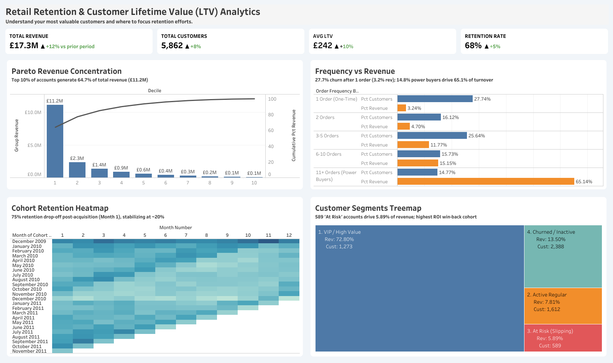

# Retail Retention & Customer Lifetime Value (LTV) Analytics

An end-to-end commercial analytics project diagnosing customer churn dynamics, Pareto revenue concentration, cohort survivability, and behavioral segmentation using SQL and Tableau Desktop.

Project Deliverables:
Executive Presentation: [View Slide Deck (PDF)](docs/executive-presentation.pdf)
Interactive Tableau Dashboard: [Tableau Public Live Viz](https://public.tableau.com/views/RetentionandRFMCaseStudy/RetailRetentionCustomerLifetimeValueLTVAnalytics)

## Summary

This project analyzes transactional retail data comprising **£17.3M in total revenue across 5,862 customer accounts**. The investigation identifies systemic drop-off friction, evaluates customer lifetime value trajectories, and provides a clear strategic roadmap to defend core revenue.

### Key Commercial Takeaways:
- **Severe Revenue Concentration (Pareto):** The top 10% of customers (Decile 1) generate **£11.2M (64.7%)** of total portfolio revenue. Deciles 1 through 3 drive over 85% of total enterprise value.
- **The First-Purchase Cliff:** **27.74% of acquired customers defect after a single order**, contributing only 3.24% of revenue. In contrast, recurring power buyers (11+ orders) represent 14.77% of customers but generate 65.14% of turnover.
- **Cohort Retention Decay:** Customer retention drops by **~75% between acquisition (Month 0 at 100%) and Month 1** (settling into a 16%–35% band), before flattening into a stable 15%–25% baseline from Month 3 through Month 12.
- **High-ROI Intervention Cohort:** **589 'At Risk' accounts** account for **5.89% (£1.02M)** of revenue. Reactivating these warm, slipping accounts offers 3x–5x higher conversion ROI than attempting to resurrect cold churned accounts.

---

## Tableau Executive Dashboard

The interactive executive dashboard was engineered using modern SaaS dashboard principle:

### Key Dashboard Components:
1. **Executive KPI Row:** Immediate high-level visibility across Total Revenue (£17.3M), Total Customers (5,862), Average LTV (£242), and Aggregate Retention Rate (68%).
2. **Pareto Revenue Concentration:** Dual-axis chart highlighting decile-level revenue contributions alongside cumulative percentage curves.
3. **Order Frequency vs. Revenue:** Diverging comparative bar view contrasting customer volume shares against actual gross revenue impact across purchase frequency tiers.
4. **Longitudinal Cohort Retention Heatmap:** 12-month survival rate grid tracking monthly retention degradation across multi-year acquisition cohorts.
5. **Customer Segments Treemap:** Behavioral distribution mapping accounts across VIP / High Value (72.8% rev), Churned / Inactive (13.5% rev), Active Regular (7.8% rev), and At Risk (5.9% rev).

---

## 🗂️ SQL Data Pipeline Architecture

The end-to-end analytics pipeline is organized sequentially from ingestion and hygiene to analytical data marts:

| Step | Script File | Domain | Purpose & Technique |
| :---: | :--- | :--- | :--- |
| **01** | `step01_raw_ingestion_and_checks.sql` | Ingestion | Initial schema validation, null checks, and data type alignment. |
| **02** | `step02_data_cleaning_dedup.sql` | Hygiene | Removes duplicate records, transaction cancellations, and negative quantities. |
| **03** | `step03_customer_aggregation.sql` | Aggregation | Groups order frequency, lifetime spend, and purchase dates per account. |
| **04** | `step04_rfm_metrics.sql` | Feature Engineering | Computes Recency, Frequency, and Monetary parameters per customer ID. |
| **05** | `step05_cohort_monthly_retention.sql` | Cohort Analysis | Indexes acquisition cohorts and calculates relative monthly retention. |
| **06** | `step06_pareto_revenue_concentration.sql` | Concentration | Uses window functions and `NTILE(10)` to compute decile revenue shares and cumulative percentages. |
| **07** | `step07_repeat_purchase_frequency.sql` | Frequency Analysis | Segments accounts into order buckets (1, 2, 3–5, 6–10, 11+) vs. revenue shares. |
| **08** | `step08_monthly_cohort_matrix.sql` | Presentation Mart | Formats a structured 2D cohort matrix optimized for heatmap visualization. |
| **09** | `step09_ltv_calculations.sql` | Unit Economics | Models cumulative lifetime value curves and average revenue per user (ARPU). |
| **10** | `step10_customer_segmentation.sql` | Segmentation | Categorizes accounts into operational tiers (VIP, Active Regular, At Risk, Churned). |

---

## 📈 Strategic Recommendations

1. **Protect the VIP Revenue Foundation:** Deploy white-glove account management and concierge service protocols for Decile 1 customers to insulate the 64.7% baseline revenue against churn.
2. **Automate Day 14–30 Onboarding Sequences:** Eliminate the initial 75% Month 1 drop-off cliff by triggering targeted post-purchase follow-ups, replenishment notifications, and educational touchpoints immediately after the first order.
3. **Execute Targeted Win-Back Workflows:** Target marketing incentives specifically at the 589 'At Risk' accounts (£1.02M revenue) before they cross the inactivity threshold into permanent churn.

---

## 🛠️ Tech Stack
- **SQL (Google BigQuery):** Window functions, CTEs, longitudinal cohort matrices, and data cleansing.
- **Tableau Desktop:** Custom container architecture, dual-axis charts, heatmaps, and treemaps.
- **Google Docs:** Formal C-Suite Executive Analytics Report.
- **Git & GitHub:** Version control and pipeline documentation.
